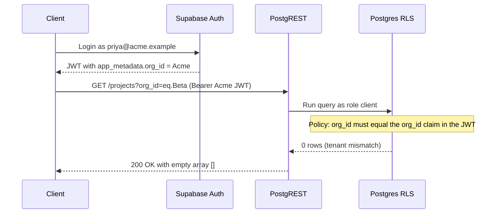
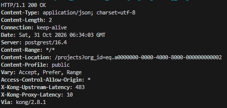

<div align="center">
  <h1>Atrium</h1>
  <p><b>A B2B Client Portal with Database-Enforced Tenant Isolation.</b></p>
  <a href="https://supabase.com/"></a>
  <a href="https://www.postgresql.org/"></a>
  <a href="https://react.dev/"></a>
  <a href="https://vitejs.dev/"></a>
</div>

<br />

## Overview

Most multi-tenant applications enforce data isolation using application-layer filters (e.g., `WHERE org_id = ?`). This approach is fragile: a single missed `WHERE` clause on a new API endpoint exposes cross-tenant data.

Atrium moves authorization into **PostgreSQL Row-Level Security (RLS)**. The frontend cannot bypass it, and the API cannot forget it.

## Architecture & Security Flow

Every row in Atrium is tied to an `org_id`. When a user logs in, Supabase Auth (GoTrue) issues a JWT containing their `org_id` in the `app_metadata` claim. When the frontend requests data, PostgREST executes the query under the user's assigned database role, and PostgreSQL enforces the tenant boundary.



### The RLS Policy

```sql
create policy projects_client_select on public.projects
  for select to client
  using ( org_id = (select (auth.jwt() -> 'app_metadata' ->> 'org_id')::uuid) );
```

### Verification Proof

If an authenticated user from Acme Corp queries data belonging to Beta Industries through a direct REST API call, the database returns an empty array. The isolation happens at the database level, not in the UI.

<div align="center">
  
</div>

## Local Development

**Prerequisites:** Node.js 18+, Docker Desktop

```bash
# 1. Clone and install dependencies
git clone https://github.com/neorylet/atrium-portal.git
cd atrium-portal
npm ci

# 2. Start the local database
npx supabase start

# 3. Add environment variables to .env.local
#    VITE_SUPABASE_URL=http://127.0.0.1:54321
#    VITE_SUPABASE_PUBLISHABLE_KEY=<key_from_supabase_start>

# 4. Start the application
npm run dev
```

> Never put the `service_role` key in `.env.local` or any `VITE_*` variable. Only the publishable (anon) key belongs in the frontend.

## Demo Credentials

The database seed creates two competing tenants to test the RLS boundaries. Passwords are supplied to the seed script through git-ignored environment variables and are not stored in this repository.

| Role         | Email                 | Scope              |
| ------------ | --------------------- | ------------------ |
| Client (Acme) | `priya@acme.example`  | Acme rows only     |
| Client (Beta) | `omar@beta.example`   | Beta rows only     |
| Agency Admin  | `dana@atrium.example` | All tenants        |

## Documentation

The full threat model, architectural decisions, and schema specs are in the [Atrium Blueprint](./docs/atrium-blueprint.html).

---

<sub>UI powered by <a href="https://github.com/supasheet/supasheet">Supasheet</a> (Apache 2.0). See their original docs <a href="./SUPASHEET_README.md">here</a>.</sub>